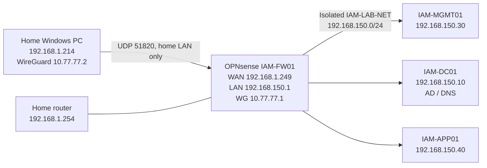

# Network topology and traffic flow

- ESXi `VM Network` carries the home-side OPNsense WAN; `IAM-LAB-NET` carries the isolated lab LAN.
- WireGuard is an encrypted logical overlay. Client traffic for `192.168.150.0/24` enters `wg0` and is routed toward `vmx0` according to firewall policy.
- The lab hosts use `192.168.150.1` as default gateway and `192.168.150.10` as DNS.
- No home-router UDP 51820 port forwarding is configured or required for same-home-LAN access.
- The gateway `192.168.1.254` is the upstream default route when installed, not a VPN endpoint.
