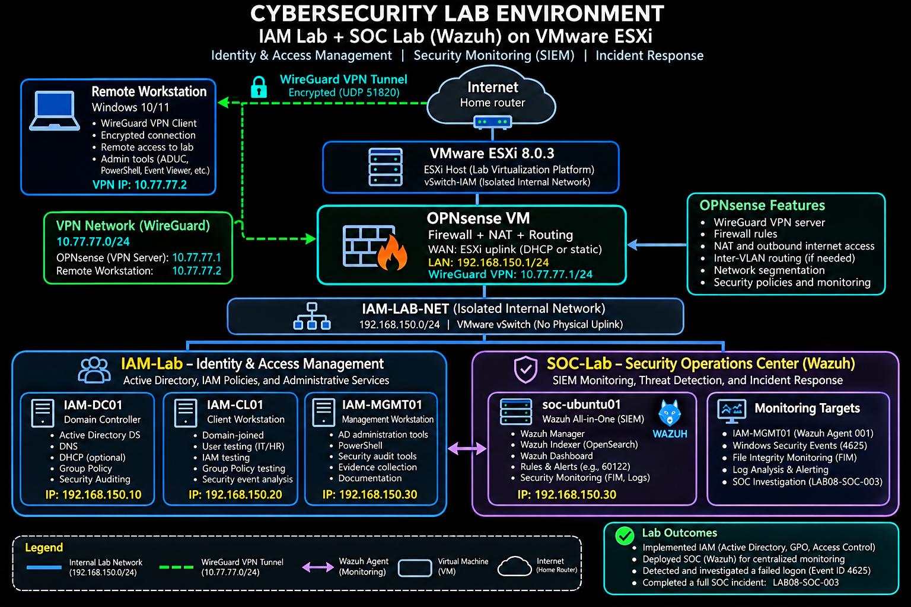

# Cybersecurity Portfolio

Welcome to my hands-on cybersecurity engineering portfolio.

I am an experienced network and telecommunications engineering professional developing practical expertise in Identity and Access Management (IAM), security monitoring, incident response, phishing detection, and cybersecurity operations.

## Featured projects

| Project | Focus | Status |
| --- | --- | --- |
| [IAM Lab](IAM-Lab/) | Active Directory, RBAC, delegated administration, Group Policy, identity security assessment, and security auditing | Lab projects documented |
| [SOC Lab](SOC-Lab/) | Wazuh monitoring, Windows security events, file integrity monitoring, alert investigation, and incident response | Lab exercises documented |
| [Phishing Email Analyser](Phishing-Email-Analyser/) | Privacy-first, browser-based phishing detection with explainable risk scoring and security recommendations | v1.0 — testing |

## Phishing Email Analyser

A static HTML, CSS, and JavaScript web application designed to analyse pasted suspicious email content locally in the visitor's browser. It looks for social-engineering pressure, credential requests, suspicious links and attachments, and email authentication failures when relevant headers are provided.

The application reports a 0–100 heuristic risk score, explains the indicators found, and offers practical next steps. It does not require accounts, a database, a backend, or external AI services. **Risk scores are educational indicators, not definitive proof that an email is safe or malicious.**

[View the application source and setup instructions](Phishing-Email-Analyser/README.md)

## IAM Lab Network Architecture

This diagram illustrates my VMware ESXi-based Identity and Access Management lab, including OPNsense firewall segmentation, Active Directory infrastructure, and isolated internal networking.

The IAM lab supports hands-on exercises in identity lifecycle management, RBAC, privileged access, and security auditing.

## Technical skills

Active Directory, RBAC, identity lifecycle management, PowerShell, Windows security auditing, VMware ESXi, OPNsense, WireGuard, Wazuh, incident response, HTML, CSS, and JavaScript.

## Career focus

IAM Analyst, Identity Security Analyst, SOC Analyst, Security Analyst, and Cybersecurity Operations roles.
