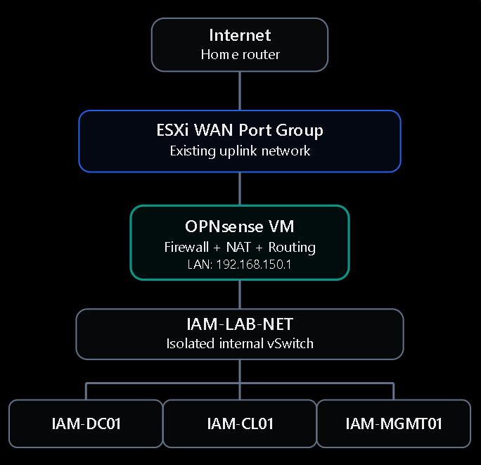

Cybersecurity Portfolio
Welcome to my hands-on cybersecurity engineering portfolio.
I am an experienced network and telecommunications engineering professional developing practical expertise in Identity and Access Management, Active Directory security, privileged access, and cybersecurity operations.

IAM Lab Network Architecture

This diagram illustrates my VMware ESXi-based Identity and Access Management lab, including OPNsense firewall segmentation, Active Directory infrastructure, and isolated internal networking.

The lab supports hands-on exercises in identity lifecycle management, RBAC, privileged access, and security auditing.

Featured IAM Projects
Project	Description	Status
07 — IAM Security Assessment
Active Directory security assessment, audit evidence, privileged access review, and risk register	Complete
Additional IAM projects will be added to this repository.
Technical Skills
Active Directory, RBAC, Identity Lifecycle Management, PowerShell, Windows Security Auditing, VMware ESXi, OPNsense, and WireGuard.
Career Focus
IAM Analyst, Identity Security Analyst, and Cybersecurity Operations roles.
