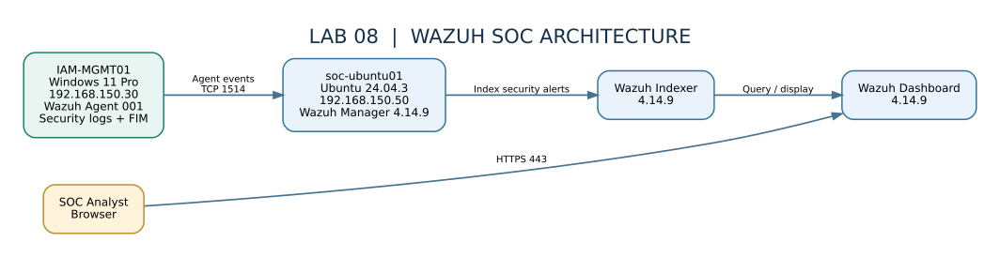
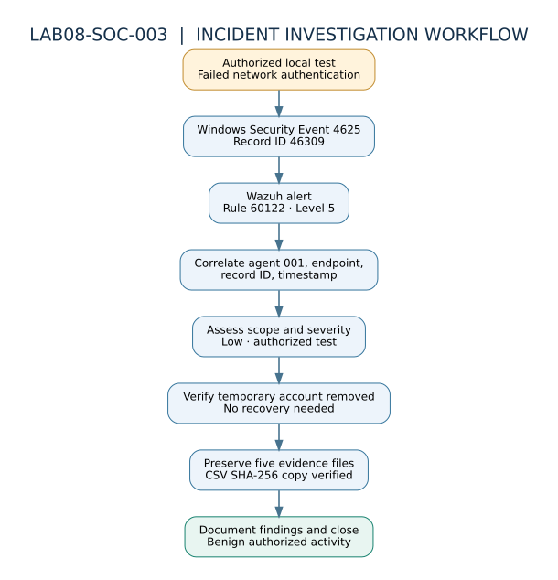

# Cybersecurity Lab 08 — Wazuh SOC & SIEM Investigation

**Status:** Completed (Phases 1–7) · **Platform:** VMware ESXi / Ubuntu 24.04.3 / Windows 11 / Wazuh 4.14.9

## Business problem
Security operations teams need centralized visibility into endpoint activity, configuration weaknesses, file changes, and authentication failures. This lab demonstrates a repeatable SOC workflow from endpoint telemetry collection through investigation, evidence preservation, and incident closure.

## Solution and outcomes
Deployed a Wazuh SOC environment, enrolled a Windows endpoint, validated security telemetry, monitored file integrity, reviewed CIS benchmark findings, and investigated a controlled failed-authentication event.

| Capability | Verified outcome |
|---|---|
| Endpoint integration | IAM-MGMT01 enrolled as Wazuh agent `001`, active |
| Windows event ingestion | Application Event 101 observed in Wazuh |
| File integrity monitoring | Create / modify / delete detected by rules `554` / `550` / `553` |
| Security configuration assessment | 125 passed, 348 failed, 9 N/A; 26% score; no domain policy changes |
| Windows authentication | Successful Event `4624` and failed Event `4625` observed |
| SOC investigation | Rule `60122`, Event `4625`, Record `46309`, incident `LAB08-SOC-003` |
| Evidence preservation | Five evidence/documentation files verified nonempty; Wazuh CSV SHA-256 copy matched |

## Architecture

The diagram documents **lab-specific private IP addresses**, not Internet-facing endpoints. The Ubuntu SOC VM (`soc-ubuntu01`, `192.168.150.50`) runs Wazuh manager, indexer, dashboard, and Filebeat. The Windows 11 endpoint (`IAM-MGMT01`, `192.168.150.30`) sends agent telemetry to the manager over TCP 1514. Analysts access the dashboard using HTTPS.

## Detection and response workflow

1. Generate an authorized failed network authentication using a temporary local test account.
2. Verify native Windows Security Event `4625` / Record `46309`.
3. Correlate Wazuh alert `60122` with endpoint, account, and timestamp.
4. Assess severity and scope; confirm the temporary account is removed.
5. Preserve evidence, validate the CSV copy with SHA-256, and document the benign authorized-test disposition.

## Documentation

- [Full build and troubleshooting manual (PDF)](Documentation/Cybersecurity_Lab_08_Build_and_Troubleshooting_Manual.pdf)
- [Phase-by-phase completion summary](Documentation/Phase-Summary.md)
- [Incident investigation summary](Documentation/Incident-LAB08-SOC-003.md)
- [Evidence inventory and publication safeguards](Evidence/README.md)
- [Publishing checklist](Documentation/Publishing-Checklist.md)

## Scope and verification

The manual explicitly labels **VERIFIED**, **RECONSTRUCTED**, and **REFERENCE** procedures. Early installation transcripts were not fully available; reference commands are not represented as historical proof. Incident conclusions apply to the reviewed endpoint and time window, not the entire domain.

## Security note

This is a controlled training environment. Do **not** publish passwords, private keys, certificates, unredacted Windows event XML, full Wazuh exports, or identifying internal details without reviewing and sanitizing them. The repository intentionally contains **no raw incident evidence**.

## Skills demonstrated

SIEM operations · Endpoint monitoring · Windows Event Logs · Wazuh · File Integrity Monitoring · CIS assessment · SOC triage · Event correlation · Incident documentation · Evidence integrity · PowerShell · Linux
